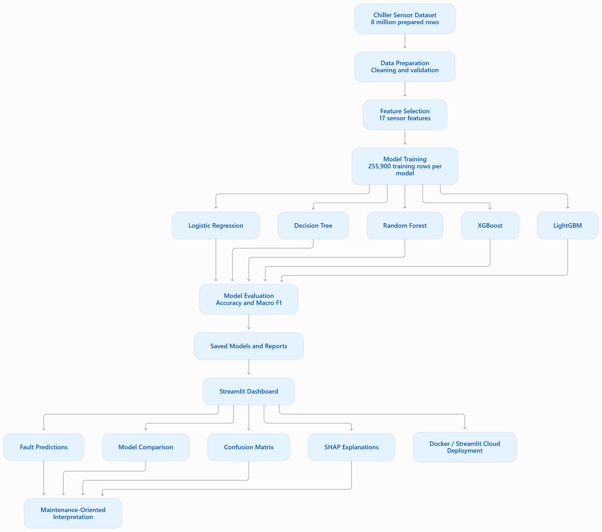
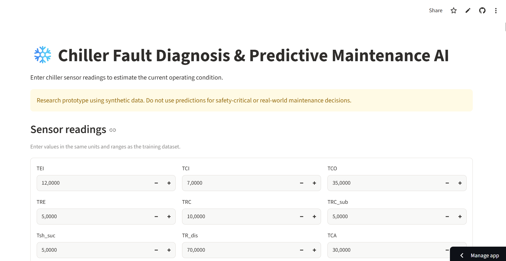

# Chiller Fault Diagnosis & Predictive Maintenance AI

An AI-powered predictive maintenance prototype that uses machine learning to identify chiller operating conditions and classify faults from sensor data.

## Project Overview

This project explores how machine learning can support chiller fault diagnosis and predictive maintenance. It uses chiller sensor measurements to classify operating conditions into eight categories and provides a Streamlit dashboard for predictions, model comparison, and model explanations.

The dataset preparation process produced an 8-million-row sample with 24 columns. The model comparison experiment used a separate dataset split containing 255,900 training rows and 64,100 test rows per model.

## System Architecture



## Key Features

- Chiller sensor data preparation and validation
- Eight-class fault classification
- Comparison of five machine learning models
- Individual fault predictions through a Streamlit dashboard
- Confusion matrix and model performance visualizations
- SHAP-based model explanations
- Chronological validation
- Docker support for local containerized execution

## Fault Categories

The models classify the following eight dataset labels:

`cf`, `eo`, `fwc`, `fwe`, `nc`, `normal`, `rl`, `ro`

## Sensor Features

The models use 17 sensor features:

`TEI`, `TCI`, `TCO`, `TRE`, `TRC`, `TRC_sub`, `Tsh_suc`, `TR_dis`, `TCA`, `kW`, `TO_sump`, `PRE`, `PRC`, `P_lift`, `CDW_DT`, `CHW_DT`, `PO_net`

## Machine Learning Models

Five classification algorithms were evaluated:

- Logistic Regression
- Decision Tree
- Random Forest
- XGBoost
- LightGBM

### Model Comparison Results


### Confusion Matrix


### SHAP Feature Contributions


### Live Dashboard



| Model | Accuracy | Macro F1 | Training Time |
|---|---:|---:|---:|
| Logistic Regression | 99.22% | 99.21% | 16.77 s |
| XGBoost | 99.13% | 99.13% | 62.51 s |
| Random Forest | 96.24% | 96.34% | 80.60 s |
| LightGBM | 94.19% | 94.16% | 25.86 s |
| Decision Tree | 90.29% | 90.68% | 6.56 s |

**Training rows per model:** 255,900  
**Test rows per model:** 64,100

Logistic Regression achieved the highest accuracy and macro F1 score in this comparison.

## Chronological Validation

A separate chronological validation experiment was performed using Logistic Regression.

| Metric | Result |
|---|---:|
| Accuracy | 99.6456% |
| Macro F1 Score | 99.6422% |
| Validation Samples | 63,769 |

The normal class had a recall of approximately 97.13%. This indicates that some normal operating samples were classified as fault categories, so further investigation and improvement may be useful.

## Streamlit Dashboard

The interactive dashboard supports:

- Fault prediction using the trained models
- Model performance comparison
- Confusion matrix visualization
- SHAP-based feature explanations
- Maintenance-oriented interpretation of predictions

## Project Structure

```text
chiller-fault-diagnosis-predictive-maintenance/
│
├── data/                       # Local datasets (not included in GitHub)
├── models/                     # Saved trained models
├── reports/                    # Model comparison and validation reports
│
├── src/
│   ├── analyze_data.py
│   ├── app.py
│   ├── evaluate_model.py
│   ├── explain_prediction.py
│   ├── inspect_data.py
│   ├── inspect_parquet.py
│   ├── inspect_time_ranges.py
│   ├── openai_explainer.py
│   ├── predict_fault.py
│   ├── prepare_dataset.py
│   ├── test_openai.py
│   ├── test_shap.py
│   ├── train_models.py
│   ├── validate_chronological.py
│   └── validate_dataset.py
│
├── .dockerignore
├── .gitignore
├── Dockerfile
├── requirements.txt
└── README.md
```

## Technologies Used

- Python
- Pandas and NumPy
- Scikit-learn
- XGBoost
- LightGBM
- SHAP
- Matplotlib and Seaborn
- Streamlit
- Docker
- Git and GitHub

## Run Locally

### 1. Clone the repository

```bash
git clone https://github.com/srichandanasiripurapu/chiller-fault-diagnosis-predictive-maintenance.git
cd chiller-fault-diagnosis-predictive-maintenance
```

### 2. Create and activate a virtual environment

```bash
python -m venv .venv
```

Windows PowerShell:

```powershell
.venv\Scripts\Activate.ps1
```

### 3. Install dependencies

```bash
pip install -r requirements.txt
```

### 4. Run the Streamlit dashboard

```bash
python -m streamlit run src/app.py
```

Open the local URL displayed in your terminal.

## Run with Docker

Build the Docker image:

```bash
docker build -t chiller-fault-diagnosis .
```

Run the container:

```bash
docker run --name chiller-app -p 127.0.0.1:8600:8501 chiller-fault-diagnosis
```

Open:

`http://localhost:8600`

## Live Dashboard

[**Open Chiller Fault Diagnosis Dashboard**](https://chiller-fault-diagnosis-predictive-maintenance-hdfhnktdnqrnlnz.streamlit.app/)

## Notes and Limitations

- The dataset is synthetic and may not represent every real-world chiller operating condition.
- The reported model comparison used 320,000 rows per experiment, not the entire 8-million-row prepared sample.
- Model performance on synthetic data does not guarantee the same performance on real industrial equipment.
- OpenAI-based explanations are optional and are not required to run the main dashboard.

## Author

**Srichandana Siripurapu**

GitHub: [srichandanasiripurapu](https://github.com/srichandanasiripurapu)
